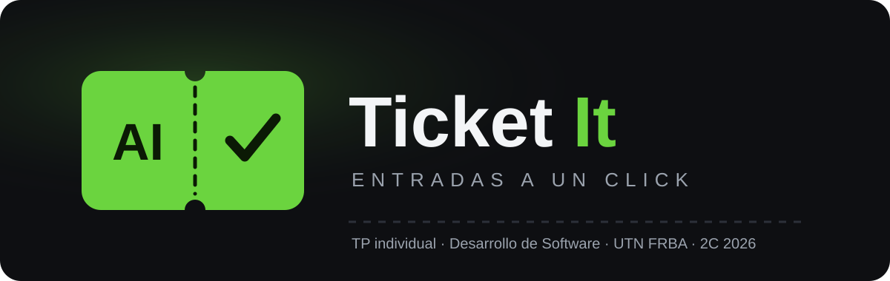
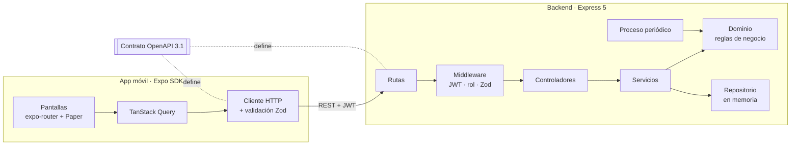
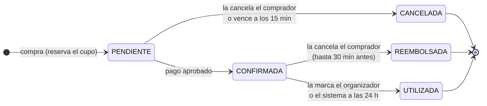

<p align="center">
  
</p>

<p align="center">
  
  
  
  
  
  
</p>

**AI Ticket It** es una plataforma móvil de venta de entradas: los organizadores publican eventos con distintos tipos
de entrada y los compradores buscan, compran, pagan, siguen su compra, chatean con el organizador, cancelan con
reembolso, reseñan y guardan favoritos.

Este repositorio es el Trabajo Práctico Individual de Desarrollo con IA (Desarrollo de Software, UTN FRBA, 2.º
cuatrimestre 2026). Más allá de la aplicación, el objetivo fue usar la IA como herramienta principal **con
criterio**: cada decisión está justificada y cada afirmación se puede verificar con una prueba.

---

## Índice

1. [Cumplimiento de la consigna](#1-cumplimiento-de-la-consigna)
2. [Decisiones y su justificación](#2-decisiones-y-su-justificación)
3. [Cómo se trabajó con IA](#3-cómo-se-trabajó-con-ia)
4. [Calidad verificable](#4-calidad-verificable)
5. [Arquitectura](#5-arquitectura)
6. [Cómo ejecutarlo](#6-cómo-ejecutarlo)
7. [Limitaciones conocidas y mejoras futuras](#7-limitaciones-conocidas-y-mejoras-futuras)

---

## 1. Cumplimiento de la consigna

### Requisitos técnicos

| Requisito                               | Cómo se cumple                                                                           |
| --------------------------------------- | ---------------------------------------------------------------------------------------- |
| Back-End con Node + Express             | Node 24 y Express 5, en capas: rutas → controladores → servicios → dominio y repositorio |
| Front-End con React Native              | React Native con Expo SDK 57 y expo-router                                               |
| Ejecución local en un dispositivo móvil | Probado en un celular Android con Expo Go, contra el backend en la PC por red local      |
| Persistencia en memoria                 | Repositorios sobre `Map`; al arrancar se cargan datos de ejemplo con fechas relativas    |
| Sin herramientas pagas                  | Todo el stack es libre o gratuito (Expo Go, Paper, TanStack Query, Jest, Swagger)        |

### Casos de uso → dónde están implementados

Cada caso de uso de la consigna se convirtió en una historia con escenarios de aceptación
([spec](specs/001-ai-ticket-it/spec.md)) y tiene pruebas automáticas.

| #   | Caso de uso (consigna)                                                         | API                                 | Pantalla           | Historia |
| --- | ------------------------------------------------------------------------------ | ----------------------------------- | ------------------ | -------- |
| 1   | Ver mis compras, su estado y los días que faltan si está confirmada            | `GET /compras`                      | Mis compras        | 4        |
| 2   | El organizador ve las compras de un evento y las entradas disponibles por tipo | `GET /eventos/{id}/compras`         | Ventas del evento  | 7        |
| 3   | Buscar eventos por texto o explorarlos por categoría                           | `GET /eventos?q=&categoriaId=`      | Explorar           | 2        |
| 4   | Crear un evento con distintos tipos de entrada, precio y cupo                  | `POST /eventos`                     | Nuevo evento       | 1        |
| 5   | El comprador envía mensajes en el chat de la compra                            | `POST /compras/{id}/mensajes`       | Chat               | 8        |
| 6   | El organizador responde mensajes en el chat                                    | `GET`/`POST /compras/{id}/mensajes` | Chat               | 8        |
| 7   | Cancelar una compra para obtener el reembolso                                  | `POST /compras/{id}/cancelacion`    | Mi entrada         | 5        |
| 8   | Cancelar solo si no está utilizada y el evento no ocurrió                      | Regla de dominio (ver decisión 2.1) | Mi entrada         | 5        |
| 9   | Puntuar y comentar una vez utilizada la entrada                                | `POST /compras/{id}/resenia`        | Mi entrada         | 9        |
| 10  | Ver las reseñas anteriores en los eventos del organizador                      | `GET /eventos/{id}`                 | Detalle del evento | 9        |
| 11  | Ordenar por precio, fecha y puntaje del organizador                            | `GET /eventos?orden=`               | Explorar           | 2        |
| 12  | Comprar eligiendo tipo y cantidad sin superar el cupo                          | `POST /compras`                     | Detalle del evento | 3        |
| +   | Guardar eventos favoritos (está en el contexto y en el diagrama, no en los 12) | `PUT`/`DELETE /favoritos/{id}`      | Favoritos          | 10       |

### Flujo elegido para el video

**Comprar → pagar → chat → cancelar o reseñar.** Recorre el back, el front y casi toda la máquina de estados de la
compra. Está cubierto de punta a punta por una prueba E2E contra el servidor real.

---

## 2. Decisiones y su justificación

### 2.1 Reglas que la consigna no define

La consigna deja abiertas varias reglas. Las definimos explícitamente en la etapa de clarificación de la
especificación, en lugar de dejarlas implícitas en el código.

| Pregunta abierta                    | Decisión                                                                                                          | Por qué                                                                                                                                                                                                                                                                                                                           |
| ----------------------------------- | ----------------------------------------------------------------------------------------------------------------- | --------------------------------------------------------------------------------------------------------------------------------------------------------------------------------------------------------------------------------------------------------------------------------------------------------------------------------- |
| ¿Hasta cuándo se puede cancelar?    | Hasta **30 minutos antes** del evento (configurable)                                                              | La consigna dice "mientras no esté utilizada y el evento no se haya realizado", pero no define cuándo una entrada pasa a utilizada. Atando ambas reglas al mismo instante, **nunca se superponen**: hasta los 30 minutos se puede cancelar y desde ahí se puede marcar como utilizada. Es un desvío consciente y está documentado |
| ¿Cómo pasa una compra a UTILIZADA?  | La marca el organizador desde 30 minutos antes; si nadie lo hace, el sistema la marca **24 h después** del inicio | Ninguna compra queda confirmada para siempre y se habilitan las reseñas                                                                                                                                                                                                                                                           |
| ¿Qué pasa con una compra sin pagar? | Vence a los **15 minutos** y libera el cupo                                                                       | Evita que alguien bloquee entradas sin pagar                                                                                                                                                                                                                                                                                      |
| ¿Hay tope por compra?               | **10 entradas** por compra                                                                                        | Evita acaparar un tipo de entrada; es el patrón habitual de las ticketeras                                                                                                                                                                                                                                                        |
| ¿Hasta cuándo se compra?            | Hasta el inicio del evento; con menos de 30 minutos, la app avisa que la compra no se podrá cancelar              | No se pierden ventas de último momento y el comprador decide informado                                                                                                                                                                                                                                                            |
| ¿Cómo se simula el pago?            | El comprador elige un medio de prueba; "Tarjeta rechazada" siempre falla y los demás siempre aprueban             | Es determinista, como las tarjetas de prueba de una pasarela real: sirve para los tests y para mostrar el reintento en el video                                                                                                                                                                                                   |

### 2.2 Decisiones de diseño técnico

| Decisión                                                                                                                                                      | Alternativas descartadas                                          | Por qué                                                                                                                                                                                          |
| ------------------------------------------------------------------------------------------------------------------------------------------------------------- | ----------------------------------------------------------------- | ------------------------------------------------------------------------------------------------------------------------------------------------------------------------------------------------ |
| **Reserva de cupo atómica**: el chequeo y la reserva ocurren en una función síncrona del repositorio, sin `await` en el medio                                 | Recontar el cupo antes y después de guardar y deshacer si se pasó | Node ejecuta un solo hilo: una sección sin `await` no se puede intercalar. Es más simple y no necesita deshacer nada. Con una base de datos real sería un `UPDATE` condicional o una transacción |
| **El cupo no se guarda: se calcula** a partir de las compras activas                                                                                          | Un contador que se suma y resta                                   | No hay contador que se pueda desincronizar: "liberar cupo" es solo cambiar el estado de la compra                                                                                                |
| **Las reglas viven solo en el dominio**: el backend devuelve qué acciones están permitidas (`puedePagar`, `puedeCancelar`…), los días que faltan y los avisos | Repetir las reglas en la app                                      | El front solo muestra o esconde botones: una regla nunca puede quedar distinta en los dos lados                                                                                                  |
| **Contrato OpenAPI primero**, escrito a mano antes del código                                                                                                 | Generar la documentación a partir del código                      | El contrato dirige el código y no al revés; cada respuesta de las pruebas se valida contra él                                                                                                    |
| **Reloj inyectable**: el dominio recibe "ahora" como parámetro                                                                                                | Usar `Date.now()`                                                 | Los plazos (15 minutos, 30 minutos, 24 horas) se prueban de forma exacta, sin esperar ni usar temporizadores falsos                                                                              |
| **Polling cada 3 s** para el chat                                                                                                                             | WebSockets                                                        | Cumple el objetivo de que el mensaje se vea en menos de 10 s, con mucha menos complejidad                                                                                                        |
| **Expo** sobre React Native                                                                                                                                   | React Native CLI con Android Studio                               | Sigue siendo React Native, pero evita instalar el SDK de Android y compilar en WSL                                                                                                               |
| **JavaScript** con validación Zod en los bordes                                                                                                               | TypeScript                                                        | Continuidad con el TP grupal y una tecnología nueva por vez (React Native); Zod valida en tiempo de ejecución lo que entra y lo que sale                                                         |

### 2.3 Diferencias con el diagrama tentativo

| Diagrama                     | Implementación                            | Motivo                                                               |
| ---------------------------- | ----------------------------------------- | -------------------------------------------------------------------- |
| `Usuario` sin rol            | `Usuario.rol`: COMPRADOR u ORGANIZADOR    | Los casos de uso están escritos por rol                              |
| `Resenia.puntuacion: Double` | Puntaje entero de 1 a 5                   | Más claro para el usuario; el promedio del organizador sí es decimal |
| `Resenia` asociada al evento | Una reseña por **compra** utilizada       | Garantiza que solo opine quien asistió, y una sola vez               |
| `Evento.tuPrecioEstaEntre()` | Filtro por rango de precio en la búsqueda | Se respetó la idea del método como funcionalidad                     |

---

## 3. Cómo se trabajó con IA

### 3.1 Proceso

Se usó **Spec-Driven Development** con [Spec Kit](https://github.com/github/spec-kit) y Claude Code. Antes de
escribir código se produjeron y revisaron estos artefactos (todos en [`specs/001-ai-ticket-it/`](specs/001-ai-ticket-it/)):

| Etapa          | Resultado                                                                                                                    |
| -------------- | ---------------------------------------------------------------------------------------------------------------------------- |
| Constitution   | [Principios no negociables](.specify/memory/constitution.md): capas, test-first, reglas solo en el dominio, contrato primero |
| Especificación | 10 historias con 61 escenarios de aceptación y 29 requisitos funcionales                                                     |
| Clarificación  | 4 preguntas sobre reglas que la consigna no define (sección 2.1)                                                             |
| Plan           | Investigación con alternativas, modelo de datos y contrato OpenAPI                                                           |
| Tareas         | 105 tareas ordenadas, con las pruebas antes de la implementación                                                             |
| Análisis       | Revisión cruzada de spec, plan y tareas: encontró 12 inconsistencias, que se corrigieron antes de programar                  |

### 3.2 Controles para no confiar a ciegas

- **Pruebas antes que código**: cada historia empezó con sus pruebas en rojo; "terminado" significa "en verde".
- **Contrato verificado**: las respuestas reales se validan automáticamente contra el OpenAPI.
- **Documentación oficial, no memoria del modelo**: versiones y APIs de Expo, React Native Testing Library y WSL
  se consultaron en la documentación vigente antes de usarlas.
- **Decisiones humanas**: las reglas de negocio abiertas, el diseño visual y el alcance los decidió el autor; la IA
  propuso opciones con sus ventajas y desventajas.
- **Registro de cada paso** en [`docs/ai-log.md`](docs/ai-log.md).

---

## 4. Calidad verificable

| Suite                                      | Comando                             | Pruebas     |
| ------------------------------------------ | ----------------------------------- | ----------- |
| Backend: unitarias, integración y contrato | `npm test --prefix backend`         | 190         |
| Backend: E2E contra el servidor real       | `npm run test:e2e --prefix backend` | 4           |
| App: pantallas y componentes               | `npm test --prefix mobile`          | 58          |
| Estilo                                     | `npm run lint`                      | sin errores |

Pruebas destacadas:

- **Concurrencia**: 50 compras simultáneas sobre un cupo de 10 dan exactamente 10 aceptadas y 40 rechazadas. Hay
  además una **prueba de control**: una versión "ingenua" con `await` entre el chequeo y la reserva vende de más, lo
  que demuestra que la prueba detectaría el error.
- **Cobertura del contrato**: las 21 operaciones del OpenAPI están implementadas y sus respuestas lo cumplen.
- **Flujo del video de punta a punta**, con el servidor real y los datos de ejemplo.
- **Plazos exactos**: con 30 minutos justos ya no se puede cancelar y sí marcar como utilizada; a los 15 minutos
  justos vence una compra sin pagar.

---

## 5. Arquitectura



### Ciclo de vida de una compra



Cada cambio de estado queda registrado con quién lo hizo (comprador, organizador o sistema) y cuándo.

### Interfaz

La app tiene un sistema de diseño propio (estilo nocturno, tarjetas con forma de entrada troquelada, tipografía
Poppins), documentado como una _skill_ del proyecto en [`.claude/skills/ticketit-ui/`](.claude/skills/ticketit-ui/SKILL.md)
para que cualquier pantalla nueva lo respete.

---

## 6. Cómo ejecutarlo

> La guía completa (red entre WSL y el celular, firewall, Expo Go y escenarios de validación) está en
> [`specs/001-ai-ticket-it/quickstart.md`](specs/001-ai-ticket-it/quickstart.md).

```bash
# Dependencias
npm install && npm install --prefix backend && npm install --prefix mobile

# Backend: http://localhost:3000 · documentación interactiva: http://localhost:3000/api-docs
npm run dev:backend

# App: crear mobile/.env con EXPO_PUBLIC_API_URL=http://<IP-de-la-PC>:3000
npm run start:mobile      # y escanear el QR con Expo Go (SDK 57)
```

**Usuarios de prueba** (contraseña `demo1234`): organizadores `martina@tickets.test` y `joaquin@tickets.test`;
compradores `ana@tickets.test`, `bruno@tickets.test` y `carla@tickets.test`.

Los datos de ejemplo se generan al arrancar, con fechas relativas a ese momento: un evento que empieza en unos 20
minutos, uno mañana, uno en 20 días, eventos pasados con reseñas, compras en todos los estados y un chat iniciado.

---

## 7. Limitaciones conocidas y mejoras futuras

| Limitación                                                                                         | Mejora posible                                                          |
| -------------------------------------------------------------------------------------------------- | ----------------------------------------------------------------------- |
| Los datos se pierden al reiniciar (lo pide la consigna)                                            | Base de datos; la reserva atómica pasaría a ser un `UPDATE` condicional |
| No se modelan eventos cancelados o cortados a mitad: sus compras pasarían a utilizadas a las 24 h  | Que el organizador pueda cancelar el evento con reembolso masivo        |
| No hay registro de usuarios ni edición de eventos                                                  | Alta de cuentas y edición con reglas sobre las compras existentes       |
| El QR de acceso por mail es solo un aviso: no se envían mails                                      | Envío real y validación en la puerta                                    |
| Las imágenes de los eventos de ejemplo son externas (picsum.photos)                                | Subida de imágenes propias                                              |
| Las pruebas de la app dejan un aviso de temporizadores abiertos al terminar (no afecta resultados) | Identificar el componente y limpiarlo                                   |

Las decisiones completas, con fechas y alternativas, están en [`docs/ai-log.md`](docs/ai-log.md) y
[`specs/001-ai-ticket-it/research.md`](specs/001-ai-ticket-it/research.md).
