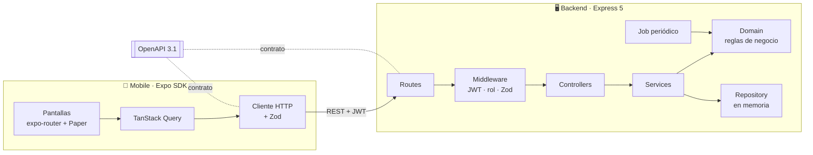
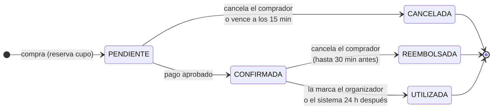

<p align="center">
  
</p>

<p align="center">
  
  
  
  
  
  
  
</p>

<p align="center">
  <b>Plataforma móvil de venta de entradas para eventos.</b><br>
  Los organizadores publican eventos con distintos tipos de entrada; los compradores buscan, compran, pagan,<br>
  chatean con el organizador, cancelan con reembolso, reseñan y guardan favoritos.
</p>

---

## ✨ Qué hace

| Comprador                                                                                       | Organizador                                                                                        |
| ----------------------------------------------------------------------------------------------- | -------------------------------------------------------------------------------------------------- |
| 🔎 Busca eventos por texto o categoría, filtra por precio y ordena por fecha, precio o puntaje  | 🎫 Publica eventos con varios tipos de entrada (General, Platea, VIP…), cada uno con precio y cupo |
| 🛒 Compra eligiendo tipo y cantidad, sin superar el cupo                                        | 📊 Ve las ventas de cada evento y la disponibilidad por tipo                                       |
| 💳 Paga con un pago simulado (con una tarjeta que siempre se rechaza, para probar el reintento) | ✅ Marca entradas como utilizadas al llegar el evento                                              |
| 🎟️ Sigue sus compras como entradas digitales, con los días que faltan                           | 💬 Responde consultas por el chat de cada compra                                                   |
| ↩️ Cancela con reembolso hasta 30 minutos antes                                                 | ⭐ Construye su reputación con las reseñas de sus eventos                                          |
| ⭐ Reseña después de asistir · ❤️ Guarda favoritos                                              |                                                                                                    |

## 🧠 Cómo se construyó

Este TP explora el **desarrollo de software con IA como herramienta principal**, con criterio y verificación:

1. **Spec-Driven Development** con [Spec Kit](https://github.com/github/spec-kit): constitution → spec → clarify →
   plan → tasks → analyze → implement. Todos los artefactos están en [`specs/001-ai-ticket-it/`](specs/001-ai-ticket-it/).
2. **Contrato primero**: la API se definió en [OpenAPI 3.1](specs/001-ai-ticket-it/contracts/openapi.yaml) antes de
   escribir código, y cada respuesta de los tests se valida contra ese contrato.
3. **Test-first**: cada historia empezó con sus tests en rojo.
4. **Registro de decisiones y del uso de IA** en [`docs/ai-log.md`](docs/ai-log.md): aciertos, errores detectados,
   correcciones y la reflexión final.
5. **Sistema de diseño como skill**: el estilo de la app está documentado en
   [`.claude/skills/ticketit-ui/`](.claude/skills/ticketit-ui/SKILL.md) para que toda pantalla nueva lo respete.

## 🏗️ Arquitectura



- **Las reglas viven solo en el dominio.** El front recibe todo calculado (`acciones`, `diasParaEvento`,
  `avisoNoCancelable`) y solo muestra lo que el backend habilita.
- **Reserva de cupo atómica**: una sección síncrona del repositorio. Con 50 compras simultáneas sobre cupo 10 se
  aceptan exactamente 10 (y hay un test de control que demuestra que una versión con `await` vendería de más).
- **Reloj inyectable**: el dominio nunca llama a `Date.now()`; los plazos se prueban de forma determinista.

## 🔄 Ciclo de vida de una compra



Cada cambio de estado queda registrado con **quién** lo hizo y **cuándo**.

## 🧰 Stack

| Módulo        | Tecnologías                                                                                       |
| ------------- | ------------------------------------------------------------------------------------------------- |
| **Back-End**  | Node 24 · Express 5 · JavaScript ESM · Zod · JWT + bcryptjs · persistencia en memoria             |
| **Front-End** | React Native (Expo SDK 57) · expo-router · TanStack Query · React Native Paper · Poppins          |
| **Contrato**  | OpenAPI 3.1 escrito a mano, servido con Swagger UI en `/api-docs`                                 |
| **Pruebas**   | Jest · supertest · Ajv (validación contra el contrato) · jest-expo · React Native Testing Library |

Todo es gratuito y corre de forma local; la app se usa desde un celular Android con Expo Go.

## 🚀 Cómo correrlo

> Guía completa (red WSL ↔ celular, firewall, Expo Go y escenarios de validación):
> [`specs/001-ai-ticket-it/quickstart.md`](specs/001-ai-ticket-it/quickstart.md)

```bash
# 1. Dependencias
npm install && npm install --prefix backend && npm install --prefix mobile

# 2. Backend → http://localhost:3000  ·  Swagger → http://localhost:3000/api-docs
npm run dev:backend

# 3. App (con mobile/.env → EXPO_PUBLIC_API_URL=http://<IP-de-la-PC>:3000)
npm run start:mobile      # escanear el QR con Expo Go (SDK 57)
```

### 👤 Usuarios de prueba — contraseña `demo1234`

| Rol          | Email                                                            |
| ------------ | ---------------------------------------------------------------- |
| Organizadora | `martina@tickets.test`                                           |
| Organizador  | `joaquin@tickets.test`                                           |
| Compradores  | `ana@tickets.test` · `bruno@tickets.test` · `carla@tickets.test` |

Al arrancar se cargan datos de ejemplo **con fechas relativas a ese momento**: un evento que empieza en ~20 minutos,
uno mañana, uno en 20 días, eventos pasados con reseñas, compras en todos los estados y un chat iniciado.

## ✅ Pruebas

| Suite                                      | Comando                             | Cantidad |
| ------------------------------------------ | ----------------------------------- | -------- |
| Backend: unitarias, integración y contrato | `npm test --prefix backend`         | 190      |
| Backend: E2E contra el servidor real       | `npm run test:e2e --prefix backend` | 4        |
| Mobile: pantallas y componentes            | `npm test --prefix mobile`          | 58       |
| Lint                                       | `npm run lint`                      | —        |

Los E2E recorren el flujo completo de la demo: comprar → pago rechazado → reintento → chat → cancelar con reembolso,
y comprar → marcar como utilizada → reseñar.

## 📁 Estructura

```text
backend/    API REST en capas: routes → controllers → services → domain / repository
            (+ schemas Zod, middleware, errors, jobs, seed)
mobile/     App Expo: src/app (pantallas por rol), src/api, src/hooks, src/components, src/theme
specs/      Spec Kit: spec, plan, research, data-model, contrato OpenAPI, tasks, quickstart
docs/       Registro de decisiones y del uso de IA
.specify/   Constitution del proyecto (principios no negociables)
```

## 📌 Decisiones destacadas

| Decisión                                  | Por qué                                                                                                                 |
| ----------------------------------------- | ----------------------------------------------------------------------------------------------------------------------- |
| Límite de cancelación de 30 min           | La consigna no define cuándo una entrada pasa a utilizada; atar ambas reglas al mismo instante evita que se superpongan |
| UTILIZADA manual o automática a las 24 h  | Ninguna compra queda confirmada para siempre y se habilitan las reseñas                                                 |
| Pago simulado determinista                | Como las tarjetas de prueba de una pasarela real: el resultado depende solo del medio elegido                           |
| Persistencia en memoria con cupo derivado | El cupo no es un contador: se calcula de las compras activas, así liberar cupo es solo cambiar el estado                |
| Expo + Expo Go                            | React Native sin Android Studio ni builds nativos en WSL                                                                |

Todas las decisiones, con alternativas descartadas, están en [`docs/ai-log.md`](docs/ai-log.md) y
[`specs/001-ai-ticket-it/research.md`](specs/001-ai-ticket-it/research.md).

---

<p align="center">
  Trabajo Práctico Individual de Desarrollo con IA · Desarrollo de Software · UTN FRBA · 2.º cuatrimestre 2026
</p>
